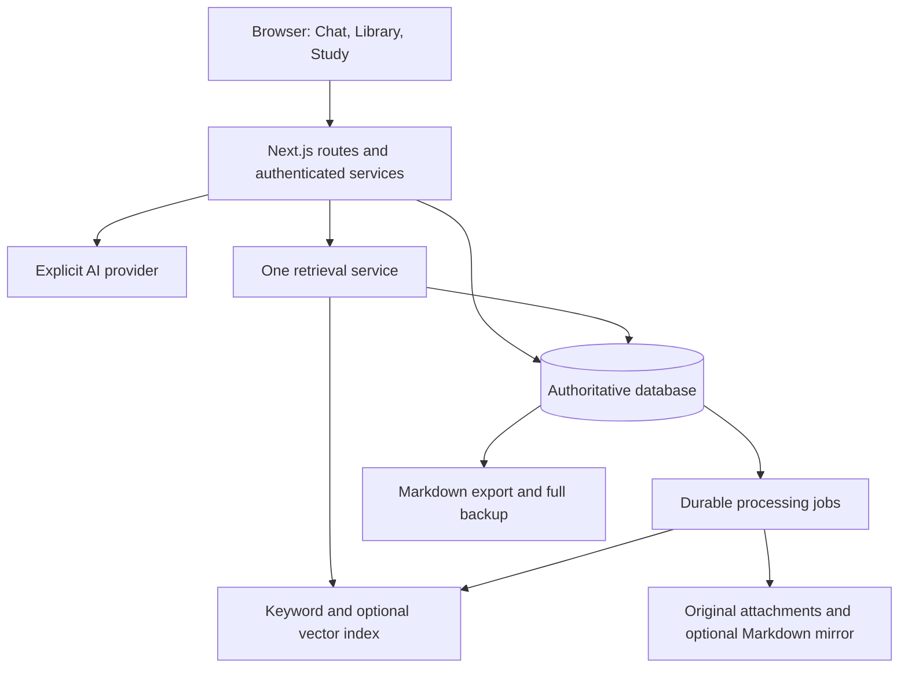

Architecture review — MyAI personal second brain

> Implementation update, 2026-09-19: P01–P04 and P05.01–P05.10 are implemented: PostgreSQL persistence, private owner access, typed OpenRouter calls, usage controls and a durable worker runtime. P05.11 live compatibility awaits the owner's key. P06 adds the explorer, direct capture/improvement review and note history/lifecycle workspace; its browser acceptance is pending. P07 adds explicit chat modes, recoverable turns, history management and reviewed typed tools. P08/P09 now add production projection handlers, unified scoped retrieval, exact-version citations, checked Ask claims and curated graph controls. Live quality and browser acceptance remain open; next implementation is P10.01. See docs/P08-P09-IMPLEMENTATION.md. See [TODO.md](TODO.md) and [the P05 report](docs/P05-IMPLEMENTATION.md); the original audit below is historical.

> Status update, 2026-09-18: This is the historical audit of the earlier prototype. Read [general.txt](general.txt) for the current authoritative product and architecture, and [TODO.md](TODO.md) for verified status and the ordered implementation plan. The owner has since confirmed a single private owner per installation, folder + capture, optional improvement, automatic saving of slash-generated answers, and OpenRouter for generation, embeddings and native reranking. PostgreSQL + pgvector with relational graph tables is the selected target. Earlier conditional SQLite/Turso/deployment recommendations and optional-only generated-answer saving below are superseded where they conflict. The recorded defects and probe results remain relevant; this documentation update did not fix the application code.

Reviewed on 2026-09-17 against `general.txt`, `info.txt`, and the current working tree, including its existing uncommitted changes. This is an assessment and implementation recommendation; application source code was not changed.

The architecture is a useful prototype foundation, but it is not yet a reliable online second brain. Keep the Next.js/React/TypeScript application, modular memory engine, portable Markdown, and keyword search. The immediate work is correctness, consistent persistence, private access, and a complete capture-to-revision experience. Adding more AI infrastructure before these are fixed would increase maintenance without fixing the main product problems.

The intended first audience was not confirmed during this review. Recommendations therefore distinguish a private account from an application with separate users. SQLite itself does not prevent multiple users; the current lack of authentication and ownership enforcement does.

The product should support this complete loop:

```text
User supplies a message, note, or document
  -> preserve the original source according to retention preferences
  -> extract useful knowledge with provenance
  -> suggest or assign topics; let the user correct them
  -> create/update versioned notes without losing previous details
  -> retrieve relevant passages with source links
  -> answer questions and generate revision questions
  -> record actual attempts and schedule future review
```

`general.txt` describes broader subject areas and saving useful question/answer knowledge. `info.txt` narrows much of the product to developer details and explicitly rejects silently storing general AI answers. Resolve that tension explicitly: retain original inputs and chosen conversations, automatically extract user-provided facts, and offer **Save this answer** for generated explanations. An optional user-enabled automatic learning mode can save AI explanations as clearly labelled drafts. A user confirming that an answer should be saved is not proof that the answer is factually correct.

| Area | Current implementation | Assessment |
|---|---|---|
| Web application | Next.js 16.3.4, React 19.2.8, TypeScript, Tailwind, shared components, desktop/mobile navigation | Suitable foundation |
| Chat | Streaming responses, saved sessions/messages, source links and memory receipts | History is not restored by the UI; topic-linked conversations are missing |
| Memory | Intent detection, path classification, candidate resolution, verification, create/update/merge | Good separation of responsibilities; serious execution and preservation gaps |
| Knowledge UI | Topic tree, recent/important lists, Markdown/code rendering, edit/delete/move | Substantial functionality; inconsistent storage paths undermine it |
| Storage | SQLite plus partial Turso adapter, optional Markdown mirror | Incomplete migration between two architectures |
| Retrieval | SQLite FTS5, optional Qdrant, ranking and contradiction helpers | Useful starting point; multiple competing retrieval paths and incomplete grounding |
| Study | Review modes, counters, forgetting score, generated MCQs | Prototype learning logic; scoring and scheduling need work |
| Import/export | Markdown/ZIP, ChatGPT import, vault ZIP export | Full-content persistence and DB-only export are incomplete |
| Online access | Dockerfile, Compose, serverless path detection | Production build fails; no authentication; persistence is deployment-dependent |

The following findings should drive the implementation order. “Reproduced” means exercised against temporary data, not inferred only from comments.

| Priority | Finding and evidence | Required change |
|---|---|---|
| Release blocker | `npm run build` and TypeScript fail on six undefined `useTurso()` references in `src/lib/vector/pending.ts:44`; the declared helper is `tursoConfigured()` | Repair the calls and verify both local and remote queue paths |
| Release blocker | No authentication/authorization boundary protects chat, notes, exports, settings or import APIs. Unauthenticated reads and a note write succeeded in the isolated local instance | Require a session before personal data access; enforce ownership at the data layer; restrict provider settings |
| Data integrity | **Reproduced:** the same fact submitted twice executes `CREATE` twice, regenerates the note, and leaves version at 1. `resolveMemory` returns `IGNORE`, verification accepts it, and both engine entry points fall through to create (`src/lib/memory/engine.ts:38`, `:81`, `:128`) | Make action dispatch exhaustive; `IGNORE` must perform no mutation; avoid destructive create-upserts |
| Persistence | Turso covers only part of knowledge access. Chat, settings, review, quiz, insights, imports, edits/moves, and older search paths still call local `getDb()` | One repository layer and one authoritative database for every feature |
| Persistence/UI | **Reproduced:** with `VAULT_MIRROR=false`, saving a note and reading its API return 200, its direct knowledge page returns 404, and ZIP export returns 404. The page and export still require files (`src/app/knowledge/[...path]/page.tsx:22`, `src/app/api/export/route.ts:13`) | Render and export from the authoritative database; treat the file mirror as optional |
| Import correctness | Markdown import writes the file and FTS text but only `content_preview` into `memories`, omitting full `content` (`src/app/api/import/route.ts:110`) | Persist full content, metadata, version and indexing job together; make conflict policy explicit |
| Quiz correctness | **Reproduced:** answer `a` is marked correct for `Because the queue size changes`; repeated submissions produce score 3 for one question (`src/lib/quiz/generator.ts:167`) | Grade stored question/option IDs server-side and make each attempt submission idempotent |
| Quiz trust | The API accepts `question.correctAnswer` and `memoryId` from the client instead of loading the question belonging to the session (`src/app/api/quiz/route.ts:44`) | Accept only session ID, question ID and answer; validate ownership and membership |
| Knowledge fidelity | Note creation asks the LLM to add concepts, pitfalls and code examples, then saves the entire generated note as confirmed (`src/lib/memory/creator.ts:28`). This can promote unsourced additions to personal knowledge | Preserve verbatim source material and distinguish user facts, AI explanations, and reviewed content |
| Privacy | Explicit Ollama mode can fall through to a configured cloud provider when Ollama is unavailable (`src/lib/ai/index.ts:66`) | A local-only mode must fail locally; cloud fallback must be an explicit preference, including embeddings |
| Preservation | Whole-document LLM rewrites have no content-preservation check or expected-version condition. Concurrent updates can overwrite each other; Turso writes do not create the version history that local writes create | Append facts or apply bounded edits; add optimistic concurrency and consistent version snapshots |
| Reliability | Storage failures can silently fall back to an in-memory database (`src/lib/db.ts:17`). Serverless `/tmp` is also temporary | Fail visibly for unavailable production persistence; temporary/demo storage should be explicitly selected |

There are additional architectural gaps worth addressing while consolidating these paths:

1. **Ownership is not implemented by adding `user_id`.** Most operations do not filter by it, the default owner is `local`, and paths are globally unique. Chats, review sessions, quiz sessions and settings lack ownership columns. Obtain the owner from the authenticated server session, not a request parameter. Apply scope before keyword/vector candidate limits. Use `(owner_id, path)` uniqueness, and stable note IDs for references. A title or folder move should not break chat citations.

2. **The storage interface is too narrow.** `KnowledgeStore` supports only a few note operations, so callers bypass it. Extend repositories for notes, topics, sources, chats, attempts, settings and jobs; keep SQL out of route handlers and UI components. Remove alternate code paths once migrated. `KB_STORE` is declared but not used to select the implementation, so it currently implies a choice that does not exist.

3. **Database migrations need to be explicit.** Local initialization creates the `status` index before adding `status` to older databases; an older schema can fail before its migration runs. Turso creates a subset of tables but lacks a complete migration history and behavioral parity. Test migration from a copy of an older database before release.

4. **Verification currently means heuristic checking, not factual verification.** LLM JSON is parsed/cast rather than validated against a runtime schema. Confidence is supplied by the model. Contradiction checks cover a few regex patterns; blocked conflicts do not create a durable review item, and update paths ignore the proposed status. Validate action enums, types, lengths and ranges; persist proposals/conflicts; give users an inbox to resolve them. Require explicit confirmation for deletion and keep recoverable trash.

5. **Retrieval is fragmented.** `/api/search` and initial chat context use the older local-SQLite search. The hybrid layer uses `KnowledgeStore`, while `retrieveFor` has no call sites. The store's FTS query limits candidates without ordering by BM25 relevance. A Turso FTS result can produce a source link without supplying its passage to chat because semantic context text is gated on `semanticUsed`. Use one retrieval service with keyword ranking, optional semantic search, ownership/status filters, and an explicit evidence budget.

6. **Document chunks are needed for broader data.** Currently vectors represent a truncated whole note, chat context often takes only initial text, semantic augmentation uses approximately 220-character excerpts, and quiz generation takes the first 1,000 characters. Important details later in documents can be missed. Store heading-aware passages with source offsets, language/code metadata, content hashes and embedding versions. Retrieve relevant passages and surrounding context; avoid splitting code arbitrarily. Topic summaries and broad revision should enumerate topic content separately from ordinary top-k question answering.

7. **Citations need to survive the whole flow.** A `verifyAnswerCitations` helper exists but is not used by chat. Even that helper checks path membership, not whether a claim is supported by the passage. Persist citations with the assistant message, link to the exact note/source version, and test unsupported claims. Treat retrieved text as evidence, not instructions. The chat API also accepts caller-provided `system` messages and conversation history; construct trusted context from stored messages on the server.

8. **Semantic search is optional, and its fallback has limits.** The no-key embedding implementation hashes tokens; it is not a learned semantic model. A chat provider saved through Settings does not configure the embedding provider, which reads environment configuration. Model changes need dimension/model-version tracking and a controlled reindex. Keep FTS as a functional baseline, expose actual indexing status, and only call retrieval semantic when a suitable embedding model is configured.

9. **Background work is not durable yet.** `void afterWriteIndexed()` starts work after a write, but a process can end before indexing or retry enqueueing completes. The existing queue is also broken by the undefined helper. Persist an indexing job in the same transaction as the note; drain it with retries, leases and deduplication. All write paths, including manual edits, imports, moves and deletes, must update the index. A small database jobs table and scheduled worker are sufficient initially; a separate queue product is optional.

10. **Chat needs continuity and predictable latency.** It starts a new session on every mount, sends the entire visible conversation, hits the server's 50-message ceiling, and only passes the latest eight messages to generation. Memory classification and note generation occur before streaming begins. Send the latest user message and session ID, load context server-side, maintain bounded context/summary, and show capture/indexing progress. Add cancellation, retry and request IDs so retries do not duplicate stored messages or memory mutations.

11. **Learning state should describe actual recall.** Search currently increments query counts for every returned note, so merely searching can label a topic as frequently forgotten. Importance also raises the forgetting score. Keep importance, interest and recall difficulty separate. Store explicit question attempts and remembered/forgotten reviews, plus `next_review_at` and interval/history. A simple spaced-review schedule is enough first. Use per-fact review cards so “BFS queue size” and “when to mark visited” can have different mastery states. Derive topic mastery from those cards and show uncertainty when there is little evidence.

12. **More question types require real support.** The types mention short answer, debugging and code completion, but the generator asks for MCQ and the evaluator uses string comparisons. Support exact option-ID grading for MCQ first; add rubrics and reviewable grading for free text later. Store source-note versions with questions. When no personal material exists, say so and label starter questions as general material.

13. **Operational protection is part of online usability.** Add per-user request/AI cost limits, request timeouts, upload/decompressed-size limits, and safe endpoint configuration. The current provider-test endpoint fetches arbitrary HTTP(S) destinations; restrict it to administrators and trusted endpoints, with a deliberate exception for self-hosted local AI. Provider keys stored in the settings table are plaintext; use server secrets or encrypted per-user credentials. Fix filesystem containment checks using path boundaries, not just string prefixes, before exposing file-oriented features.

The recommended data model keeps originals, derived knowledge and learning history distinct:

| Entity | Responsibility |
|---|---|
| Users / sessions | Authentication and ownership |
| Topics / note-topic links | User-created or suggested hierarchy, aliases, multiple subject associations |
| Sources / attachments | Original pasted text, chat-message reference, uploaded file or fetched snapshot, origin and import state |
| Notes | Stable ID, owner, title, Markdown content, type, status, current version, timestamps |
| Note versions / source links | Change history and evidence for each derived note; generated-vs-user authorship |
| Chunks | Searchable passages, source/note version, heading or page, offsets and embedding metadata |
| Conversations / messages / citations | Recoverable chat history, topic scope and links to supporting passages |
| Review cards / schedule | Small recall targets and when they are due |
| Quiz sessions / questions / attempts | Stored answer keys, source references and deduplicated grading history |
| Jobs | Import, extraction and index work with retry state |

Start with text, Markdown and chats. Add PDFs and web links once the source/chunk pipeline is reliable; later add image/OCR or audio if needed. Store binary originals in persistent object storage for a managed deployment, or a backed-up volume for a private server. A URL alone is not a durable copy of source evidence. Existing ChatGPT import is a specialized adapter, not a general document ingestion system. Broader subjects such as college notes, exams and resumes also require generalizing the developer-only prompts and hardcoded topic heuristics.

For a web-first product, I recommend **database-authoritative Markdown**: store complete readable Markdown in the database and generate Markdown/ZIP exports from it. This intentionally revises `info.txt`'s file-authoritative principle. Portability does not require filesystem files to be the live authority. Preserve metadata in export front matter and include attachments where applicable. An optional Obsidian mirror can be generated asynchronously. If editing directly in Obsidian must synchronize back, treat that as a separate version-aware sync feature with conflicts; the current mirror does not implement bidirectional sync.

The UI should make the above system understandable without exposing implementation details:

| Surface | Recommended experience |
|---|---|
| Chat | Conversation history, topic selection or “all my knowledge,” attachments/paste, stop/retry, source links, Save answer, visible save status and Undo |
| Library | Topic tree/list, first-class topic creation, source/type filters, note editor, move/rename, original source, version history, trash and restore |
| Topic workspace | Related notes, chats and sources together, plus “Ask about this topic” and “Revise this topic” |
| Inbox | Newly imported items, uncertain captures, suggested topic assignments and conflicting facts |
| Study | Due cards, topic/weak-area quizzes, answer feedback, source note and next review date |
| Dashboard | Due review, recently added knowledge, processing failures and evidence-based weak areas |
| Settings | Account, retention/privacy, provider choice, import/export and backup status |

The current components and page shell can support these changes. The most valuable UI work is persistent history, topic context, reliable save/source links and review feedback. Folder-like slash commands can remain shortcuts. Add shared data fetching/invalidation so a saved note updates library counts and lists immediately; the existing pages often swallow errors and refresh only some views. Extract the repeated Markdown renderer and avoid reprocessing all old code blocks on every streamed token. Review mobile navigation, keyboard controls, accessible dialogs, loading/error/empty states and long content in a working browser before release. Visual quality and responsive behavior were not verified in this audit because the browser tool failed to start.

Deployment should use one of the following deliberate paths:

| Path | Components | Tradeoff |
|---|---|---|
| Smallest change for one private account | Next.js Docker app, persistent SQLite volume, optional Markdown/attachment volume, sign-in, HTTPS reverse proxy, one configured AI provider | Retains most implementation; you operate backups and the server |
| Managed online application with separate accounts | Next.js hosting, managed PostgreSQL, auth, object storage, PostgreSQL full-text search plus optional pgvector, durable jobs | More migration work now; fewer local-filesystem assumptions and simpler consolidated ownership |
| Keep Turso | Next.js, complete libSQL repositories for all state, auth, attachment storage if needed, optional Qdrant | Viable; requires finishing the partial migration and testing adapter parity |

My default recommendation for the current code is the first path if the first release is private. For a managed multi-user product, PostgreSQL with pgvector is a reasonable consolidation option, not a requirement to rewrite every layer. Supabase is one available implementation of that option; its documentation demonstrates permission-filtered vector retrieval with PostgreSQL row-level security. [Supabase RAG permissions](https://supabase.com/docs/guides/ai/rag-with-permissions)

Ordinary Vercel Functions do not provide shared persistent local SQLite storage. A successful deploy or an app booting with `/tmp` does not establish durable storage; separate instances can also disagree before a redeploy. Use an external database for that deployment model. [Vercel SQLite guidance](https://vercel.com/kb/guide/is-sqlite-supported-in-vercel)

Self-hosted Next.js supports streaming; put a reverse proxy in front of it and configure it to pass the stream without buffering. [Next.js self-hosting guidance](https://nextjs.org/docs/app/guides/self-hosting)

For the Docker path, fix the production build first, validate volume permissions for UID 1001, configure secrets through deployment settings, and test restart/restore. The image enables standalone output but still copies all `node_modules` and runs `next start`; align it with the generated standalone server and static assets. Compose does not currently provision Ollama or a model, and it hardcodes its connection settings. `localhost`/`host.docker.internal` refers to the deployed server or its host, not the user's laptop. Local AI requires an available model host and enough resources; otherwise configure an explicitly chosen remote provider. The current `.dockerignore` also does not exclude `.env*`, while the builder copies the workspace; exclude secrets from build context. Replace the scaffold README and contradictory deployment comments with one tested deployment guide.

A Markdown ZIP is a portability export, not a complete recovery backup: it omits chats, learning attempts, schedules and much application state. Back up the database consistently, include attachment data and required encryption keys separately, and test restoring into a fresh instance. Avoid silently downgrading to memory-only storage. Add health/readiness checks and useful error reporting for database, AI and indexing status.

The target architecture can remain one application:



Do not add microservices, Kubernetes, a graph database or another orchestration framework just to implement this loop. Keep LeetCode as an optional specialized view over shared notes and learning records, with linked problem metadata; avoid maintaining a separate inconsistent knowledge system for it.

Recommended delivery order:

1. **Correctness baseline:** repair build/type/lint failures; fix duplicate `IGNORE` dispatch, overwrite/version behavior and quiz grading. Add regression checks that call actual production services.
2. **One durable storage path:** choose the first deployment, route every read/write through it, store full import content, repair direct note pages and DB-based export, implement migrations and restore tests.
3. **Private access:** add sign-in and ownership enforcement before exposure; test isolation across notes, chats, search, vector results, exports and study records. Add endpoint and AI cost controls.
4. **Complete the core experience:** persistent chat history, first-class topics, source-linked capture, Save answer, undo/history, one retrieval service and source citations. Verify capture -> find -> ask -> correct -> revisit.
5. **Reliable revision:** stored questions and attempts, real recall signals, due dates, per-fact cards and topic revision. Add richer question types after MCQ and review are trustworthy.
6. **Broader ingestion and scale:** document parsing, attachments, chunked retrieval, durable processing and measured semantic search improvements. Expand beyond developer topics.

A release should pass an end-to-end acceptance scenario: save a Java detail, find it in its topic and search, ask a question with a valid source, restart the deployment, recover the conversation and note, revise it, answer a stored quiz question, see the next review date, export and restore the data, and verify another account cannot access it. Repeating a save or answer must not create duplicate effects; a failed provider call must not erase existing knowledge.

Verification performed during this review:

| Check | Result | Meaning |
|---|---|---|
| `npm run build` | Failed after compilation, during TypeScript validation | Current production release is blocked by undefined `useTurso` |
| `tsc --noEmit --incremental false` | Six errors | Same missing symbol at six call sites |
| `npm run lint` | 38 errors, 17 warnings | Type safety, hooks and other cleanup remain |
| `npm run eval` | 104 cases pass | Mostly exercises mirrored pipeline rules, not production orchestration |
| `npm run eval:retrieval` | 34 checks pass | Exercises production ranking helpers with offline fixtures; not live retrieval or LLM grounding |
| Actual memory-engine probe with a stub AI | Duplicate runs create again, changes content, version stays 1 | Existing evaluation misses a real data-integrity bug |
| Actual quiz evaluator probe | One-letter partial answer accepted; repeated score reaches 3/1 | Recall and weakness metrics can be corrupted |
| HTTP smoke checks with isolated temporary SQLite | Chat/library pages and read APIs return 200; unauthenticated note PUT also returns 200 | Basic routes render; personal APIs are unprotected |
| DB-only note scenario | API 200; direct page 404; export 404 | Optional mirror is still required by some features |
| Browser visual inspection | Not completed; browser runtime failed to start due to sandbox ACL error | No claim of visual/mobile QA |

No real cloud LLM, Turso database, Qdrant service or production host was exercised. Runtime probes used temporary data and disabled external providers. Existing user data and application source edits were preserved; the temporary development server was stopped. The working tree already contained many changes before the review.
