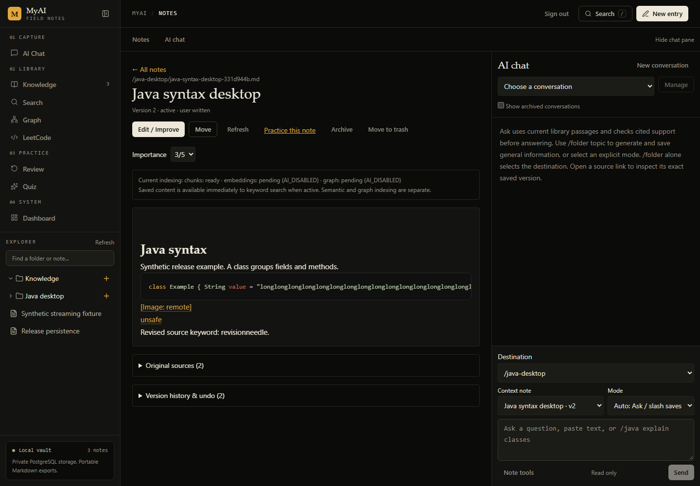
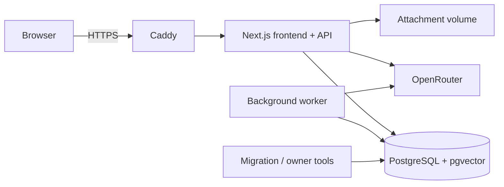

# MyAI — personal second brain

MyAI combines a VS Code-style folder explorer, readable Markdown, AI chat and source-linked retrieval. It is a **private, single-owner, self-hosted application**: everyone hosts their own installation.

Create topics such as `/java`, `/dsa` and `/java/syntax`. A folder's **+** adds notes, subfolders or imports. Save text unchanged, preview an AI improvement, or send `/java explain classes` to generate and save a note. Ask searches current sources; Practice and Review turn them into learning sessions.



Implemented features include version history, preserved originals, reviewed AI edits, scoped keyword/vector retrieval, an evidence-linked graph, seven question formats, recall scheduling, safe imports, exports and full backups. See [release evidence and limits](docs/P12-RELEASE.md). Source checks reduce unsupported answers; they do not guarantee zero hallucinations, complete retrieval or real-world freshness.

## Architecture and data



Next.js serves the frontend and backend. The worker processes durable indexing jobs. PostgreSQL holds complete readable content and derived knowledge; there is no separate graph server or required Markdown `vault/` directory.

| Data | Persistent location |
| --- | --- |
| Notes, sources, versions, graph, vectors, chat, learning, owner login | `postgres` Docker volume |
| Original uploaded bytes | `attachments` volume at `/app/data/attachments` |
| API key and deployment secrets | Untracked server `.env` or deployment environment |
| Unsaved editor drafts | Owner's browser storage |
| Markdown exports | Downloaded ZIP, derived from PostgreSQL |
| Full recovery bundles | `./backups` by default, plus your protected off-site copy |

Compose prefixes volumes with its project name (default `myai`). Local development uses `DATABASE_URL` and `DATA_DIR` (default `data/attachments`). Old SQLite files are not runtime storage. **Do not run `docker compose down -v` on an installation you want to retain.**

## First setup with Docker

Install Docker Engine/Desktop with Compose v2 and Linux containers. Docker builds the pinned Node 22 runtime. Run commands from the repository root. Allow storage for images, database, attachments and backups; resource needs grow with the library.

1. Create `.env`. With Node 22.14+ installed:

   ```sh
   node scripts/setup-env.mjs
   ```

   This generates independent database/auth secrets and refuses to overwrite an existing `.env`. Without Node, copy `.env.example` to `.env` and set independent random `POSTGRES_PASSWORD` and `BETTER_AUTH_SECRET` values. Use a hex database password in the supplied Compose URL. For local Node commands, put the same password in `DATABASE_URL`.

2. For local access keep `APP_URL=http://localhost:3000` and `APP_PORT=3000`. An API key is optional for capture, editing, keyword search, imports and exports. Keep `.env` private.

3. Build, migrate, provision the owner and start:

   ```sh
   docker compose build myai migrate
   docker compose up -d --wait db
   docker compose run --rm migrate
   docker compose run --rm migrate node --import tsx scripts/owner.ts create
   docker compose up -d --no-build --wait myai worker
   ```

   Owner setup prompts for an email and hidden 12–128 character password. Email delivery is unnecessary; public signup is disabled. Provision the owner **before** waiting for web readiness.

4. Open **http://localhost:3000**, sign in, create a folder and save a note with **No, save as written**. Search for a phrase from it and inspect Settings for worker/indexing status.

Migrations also run as a startup dependency, are serialized by a PostgreSQL advisory lock, and verify applied-file hashes. All eleven current migrations must be applied. Web, worker and maintenance images must use the same revision.

**Environment precedence:** Compose reads `.env`, not `.env.local`. Local Next/CLI commands read `.env.local` before `.env`; existing environment variables take precedence. Reconcile any existing `.env.local` before switching setups. Never share resolved Compose configuration containing secrets.

## Deploy online with HTTPS

Use a persistent Linux host. Point DNS at it, allow inbound TCP 80/443 (UDP 443 optional), and set:

```dotenv
APP_DOMAIN=brain.example.com
APP_URL=https://brain.example.com
APP_PORT=3000
```

Complete the build/migration/owner steps above, then:

```sh
docker compose -f docker-compose.yml -f compose.https.yml up -d --no-build --wait
```

Open `https://brain.example.com`. Caddy obtains/renews the certificate; retain its data/config volumes. PostgreSQL has no published port. The app port binds only to host loopback. The browser hostname must match `APP_URL`, an origin without a path/query.

The [Caddyfile](deploy/Caddyfile) limits request sizes/slow uploads and allows long AI responses. Caddy flushes `text/event-stream` automatically. Do not cache authenticated pages or enable response buffering in another proxy/CDN. See [official proxy documentation](https://caddyserver.com/docs/caddyfile/directives/reverse_proxy).

The local rehearsal checks TLS, secure cookies, origin rejection and SSE using an internal certificate. Public DNS/certificate issuance and external-network access must be verified on your actual host.

Static hosting alone is insufficient. Managed hosting needs a persistent Node web process, separate matching worker, PostgreSQL/pgvector, migration job and durable shared attachment storage. Ephemeral/serverless filesystems are unsupported for attachments. Managed-provider recipes have not been release-tested.

## Configure OpenRouter

Set `OPENROUTER_API_KEY` server-side. Select models independently:

| Setting | Required capability |
| --- | --- |
| `OPENROUTER_CHAT_MODEL` | Chat and streaming |
| `OPENROUTER_STRUCTURED_MODEL` | Strict JSON-schema output for improvements, grounded answers, graph and practice |
| `OPENROUTER_EMBEDDING_MODEL` | Exactly **1536-dimensional** embeddings |
| `OPENROUTER_RERANK_MODEL` | Native OpenRouter `/rerank` |

Example IDs do not guarantee free access. Provider/model support changes. Consult [structured outputs](https://openrouter.ai/docs/guides/features/structured-outputs) and [RAG APIs](https://openrouter.ai/docs/guides/evaluate-and-optimize/rag), then check the actual tasks:

```sh
docker compose up -d --force-recreate myai worker
docker compose exec worker node --import tsx scripts/ai-smoke.ts --live
```

These checks send synthetic text and may incur charges. Settings also offers individual checks and never returns the key. Saved Settings override environment model/toggle defaults. Keep web and worker aligned. A four-task compatibility check passed on September 21, 2026 with the following combination (not all models are free):

```dotenv
OPENROUTER_CHAT_MODEL=nvidia/nemotron-3-ultra-550b-a55b:free
OPENROUTER_STRUCTURED_MODEL=openai/gpt-4.1-mini
OPENROUTER_EMBEDDING_MODEL=openai/text-embedding-3-small
OPENROUTER_RERANK_MODEL=nvidia/llama-nemotron-rerank-vl-1b-v2:free
```

This is an observed compatibility result, not a quality benchmark or future availability guarantee. The original free structured/embedding selection failed checks; see [exact results](docs/P12-RELEASE.md). Your existing private environment was not rewritten.

After compatible checks pass, enable AI indexing and optionally reranking, then rebuild:

```sh
docker compose exec worker node --import tsx scripts/indexing.ts rebuild
docker compose exec worker node --import tsx scripts/indexing.ts status
```

New profiles activate after complete current-note coverage. Never mix dimensions/models or truncate vectors. Graph expansion is optional, off by default. Keyword search works immediately while AI is unavailable or indexing is pending.

Daily budgets include retries across web and worker. Four provider requests may run concurrently; calls have a 90-second deadline. Unreported usage remains reserved for the budget day. These controls are not a guaranteed monetary billing cap. OpenRouter receives the text used for enabled AI features.

## Daily workflow

- **Capture:** folder **+ → Add note**. Save unchanged or review an improvement. Original text and versions are retained.
- **Generate:** create `/java`, then send `/java explain classes` in Auto or Generate & Save mode. Completed output is saved; partial/failed output is not a finished note. `/java` alone selects the folder. Nested paths work.
- **Ask:** select Ask and folder/note scope. Inspect citations and saved versions. Ask is read-only and may abstain.
- **Edit:** Edit / Improve or reviewed chat tools. Version checks reject stale overwrites. Move/archive/trash/restore update current retrieval while retaining history.
- **Graph:** inspect evidence, review/correct relations, add aliases and merge equivalent concepts. Owner corrections survive rebuilds; stale evidence is excluded.
- **Learn:** Practice this note, Quiz or Review supports due/folder/weak/random/interview/exam sessions, seven formats, correction history and timezone-aware scheduling. Practice code is not executed.
- **Import/export:** folder **+ → Import notes / code** or Settings. Preview conflicts; choose skip, copy or append/merge. UTF-8 Markdown/text/code/ZIP limits: 10 MB upload, 1 MB/file, 200 content files, 20 MB expanded. JSON/ChatGPT text is preserved, not parsed into structured conversations. Try [synthetic Java content](examples/java/syntax.md).

Markdown exports include selected current notes, source text, graph evidence and manifests, but exclude full history/chat/learning/auth records and attachment bytes. **They are not full backups.**

## Backup, upgrade and rollback

Read [the recovery guide](docs/RECOVERY.md). With local Node dependencies installed:

```sh
node --import tsx scripts/recovery.ts backup before-upgrade
node --import tsx scripts/recovery.ts verify before-upgrade
```

On a Docker-only host:

```sh
docker compose stop myai worker
docker compose -f docker-compose.yml -f compose.recovery.yml run --rm recovery backup before-upgrade
docker compose -f docker-compose.yml -f compose.recovery.yml run --rm recovery verify before-upgrade
```

Backups require stopped writers and contain PostgreSQL plus ready attachment objects. Copy verified bundles off-site. MyAI does not encrypt them. Retain matching source, image tags and secrets. Backups leave writers stopped; resume with `docker compose up -d --wait myai worker` when no upgrade follows.

After backup, select the reviewed new revision and a new `MYAI_IMAGE_TAG` in `.env`:

```sh
docker compose build myai migrate
docker compose stop myai worker
docker compose run --rm --no-deps migrate
docker compose run --rm --no-deps migrate node --import tsx scripts/recovery-validate.ts
docker compose up -d --no-build --wait myai worker
```

For HTTPS also run `docker compose -f docker-compose.yml -f compose.https.yml up -d --no-build --wait`. Check login, note/history, search, attachment and worker status. Named volumes survive recreation. Retain old images until acceptance.

Rollback requires previous source/images **and a matching verified backup**, restored into a fresh Compose project with empty database/files volumes. Do not run old code against a newer database. Restore refuses nonempty targets. [Recovery instructions](docs/RECOVERY.md) cover validation, owner recovery and permanent deletion.

## Local development

Use Node **22.14+ in the 22 series**, npm and Docker. Create `.env` as above; `DATABASE_URL` must match credentials and local PostgreSQL port 55432.

```sh
npm ci
docker compose -f compose.db.yml up -d --wait
npm run db:migrate
npm run owner:create
npm run dev
```

Run `npm run worker` in a second terminal and open http://localhost:3000. The local DB uses a separate `myai-foundation` volume. Do not run both web setups on the same port. Two worker slots require at least five pool connections; production Compose allocates seven.

## Health and troubleshooting

| Check/symptom | Meaning and action |
| --- | --- |
| `/api/health` returns 200 | Web is alive; not DB/AI readiness |
| `/api/ready` returns 503 | Check DB, migrations, owner and app/auth configuration |
| Worker unhealthy/stalled | Settings or `docker compose exec worker node --import tsx scripts/indexing.ts status`; use `retry` for current failed/pending work |
| AI fails but notes work | Check each task's model/key, provider support, credits and budget; chat success alone is insufficient |
| `AI_PROFILE` | Embeddings do not match the 1536-dimensional profile |
| Sign-in loop/rejected writes | Browser origin must match `APP_URL`; remote access requires HTTPS. Recreate containers after changes |
| Forgotten password | `docker compose run --rm migrate node --import tsx scripts/owner.ts recover` with existing email; sessions are revoked |
| Interrupted upload | `docker compose run --rm migrate node --import tsx scripts/attachments.ts`; resolve integrity errors before backup |
| Environment change ignored | Recreate containers; check saved Settings and `.env.local` overrides |
| Registry unavailable at build | Restore network/registry access and retry; build needs no installation data |

Use `docker compose ps` and `docker compose logs --tail=100 myai worker migrate`. Redact personal content and secrets before sharing output.

## Validation and handoff

```sh
npm run lint
npm run typecheck
npm test
npm run build
docker compose -f compose.test.yml up -d --wait
npm run test:db
npm run test:http
npx playwright install chromium
npm run test:release
```

Checks use synthetic fixtures and isolated databases. Release checks create a random disposable Compose installation, verify persistence/restarts/HTTPS and Chromium desktop/mobile flows, and remove **only fixture volumes**. Ports 3392/3443 must be free. `node scripts/release-check.mjs --skip-build` reuses matching `p12-check` images after an unchanged build.

Live compatibility is separate: start the test DB, configure models/key, run `node --import tsx scripts/ai-release-check.ts --live`. It creates/removes a synthetic database. The optional `live-ai` GitHub workflow uses explicit dispatch and environment-managed secrets. Normal CI never calls live models.

Read [general.txt](general.txt) for the specification, [TODO.md](TODO.md) for completed/pending tasks, [P12 evidence](docs/P12-RELEASE.md), [contribution guidance](CONTRIBUTING.md) and [security guidance](SECURITY.md). The owner's open-source license selection is pending; no license has been silently chosen.
